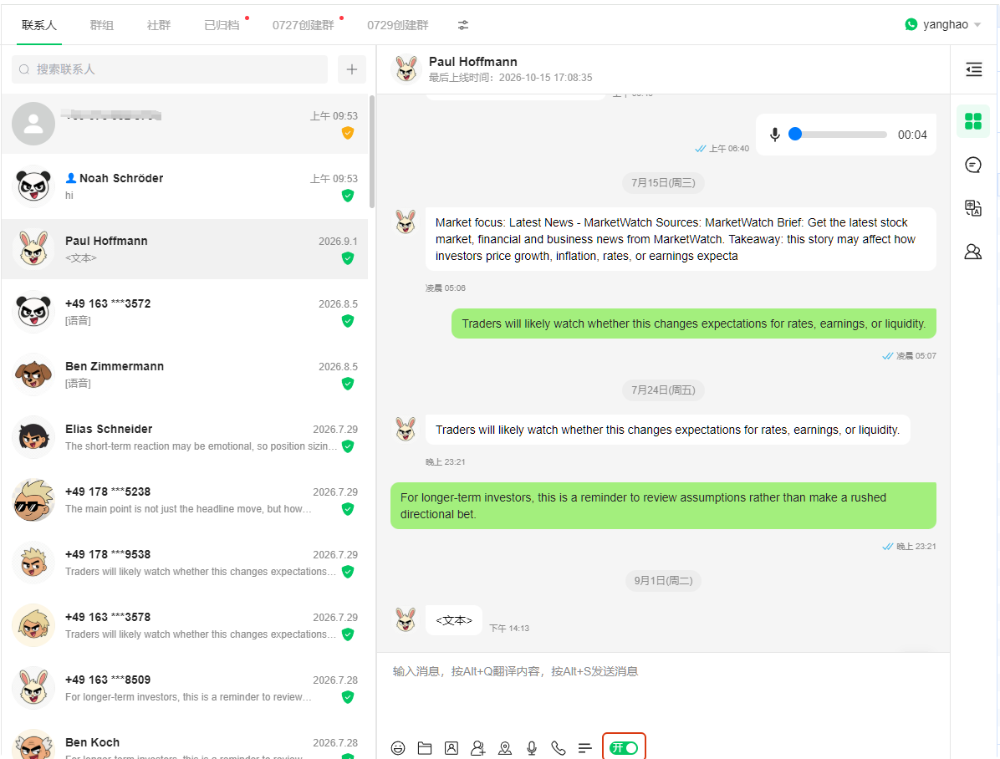
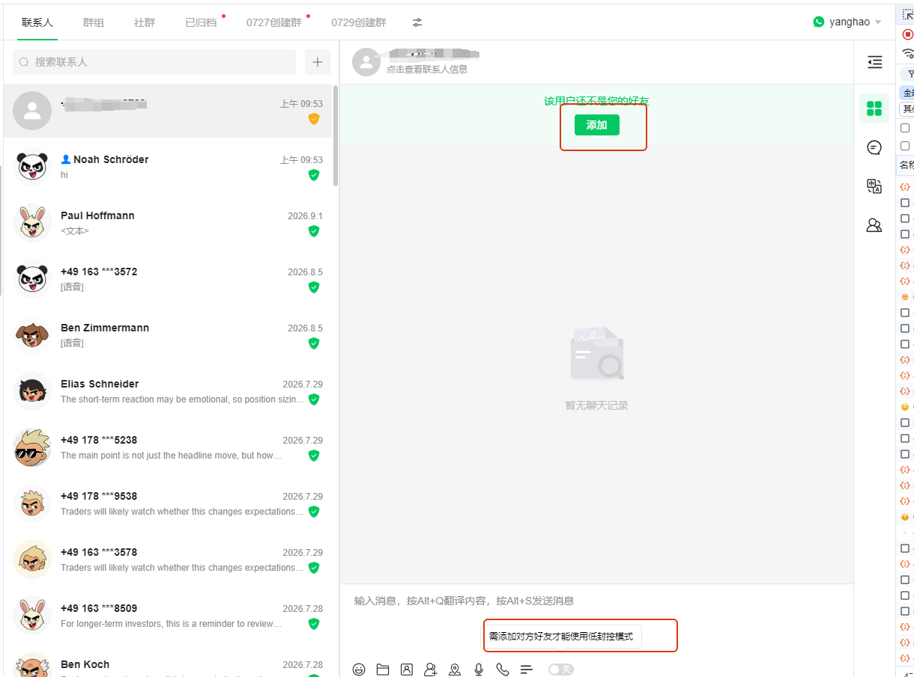
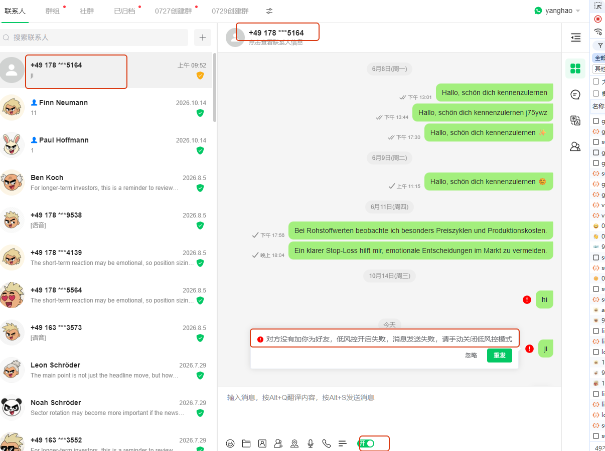
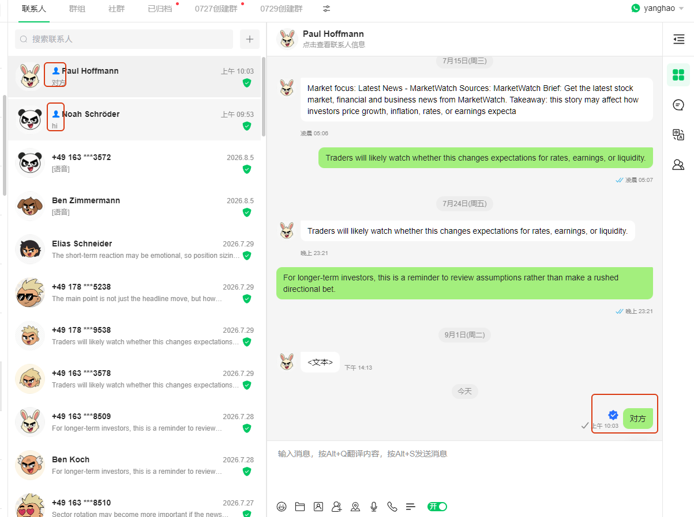
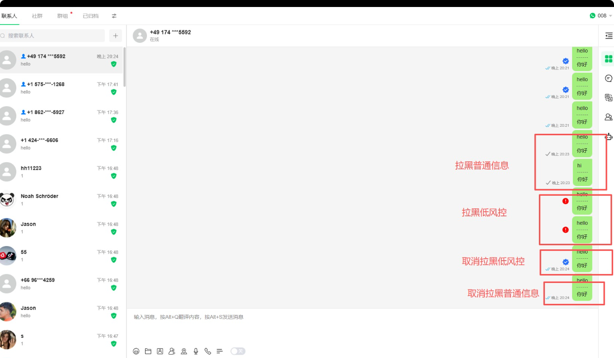
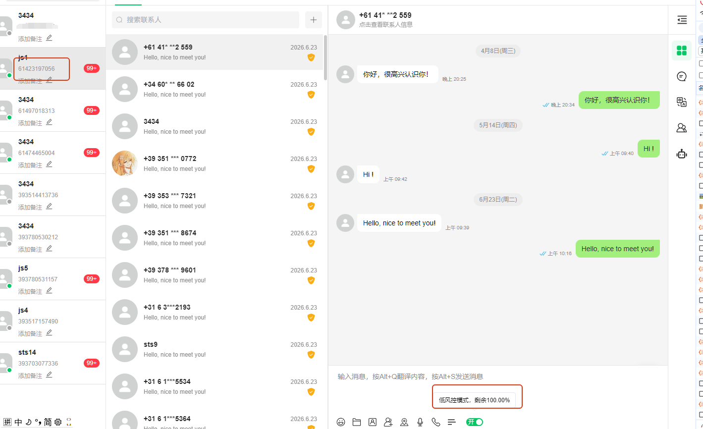
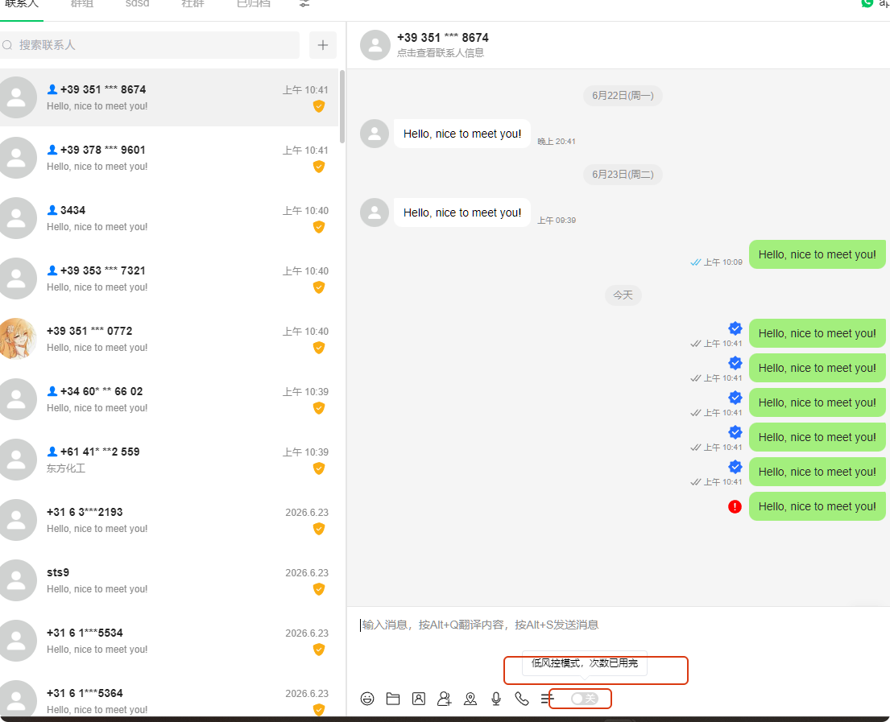

# 低风控使用教程

分类：[重要]风控相关
更新时间：2026-10-16T00:00:00+08:00
ID：6ad1871a5bc74533b1b476fa

低风控模式用于检查对方是否已将你添加为好友。开启后，双方互加好友时可以正常发送消息；对方尚未添加你，或已将你拉黑时，消息会发送失败。

## 一、如何开启低风控模式

1. 打开与对方的私聊窗口。
2. 在文本输入框下方，找到最右侧的低风控开关。
3. 点击开关，开启低风控模式。

**开启前，请先将对方添加为好友。** 如果你还没有添加对方，就无法开启低风控模式。

## 二、对方尚未添加你为好友

如果你已添加对方，但对方还没有添加你，低风控模式下的消息会发送失败，并出现以下提示：

> 对方没有加你为好友，低风控开启失败，消息发送失败，请手动关闭低风控模式。

出现此提示时，请先确认双方是否已互加好友；如需退出该模式，可手动关闭低风控开关。

## 三、双方已互加好友

双方互加好友后，在未被对方拉黑的情况下，低风控模式下的消息可以正常发送。发送成功后，可通过以下标识确认状态：

- 联系人显示“双向好友”标识。
- 消息显示“低模式”标识。

## 四、已互加好友，但被对方拉黑

即使双方已经互加好友，被对方拉黑后，低风控模式下的消息仍会发送失败。对方解除拉黑后，该模式下的消息可以恢复正常发送。

## 五、低风控额度说明

部分地区的账号设有低风控使用额度。目前已知以下地区存在额度限制：

- 澳大利亚
- 沙特阿拉伯
- 以色列

可在低风控开关处查看剩余额度百分比，如下图所示。

额度使用完后，系统会自动关闭低风控模式，暂时无法重新开启，并提示“低风控模式，次数已用完”。额度会在每月 1 日刷新，刷新后即可继续使用。

